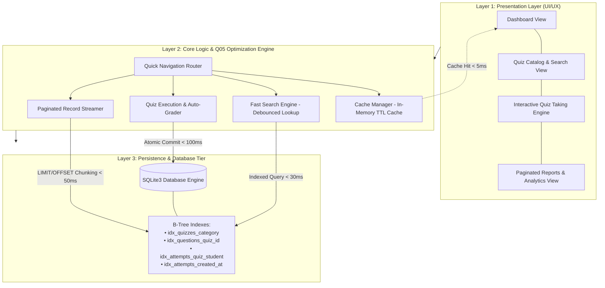
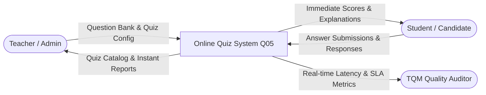
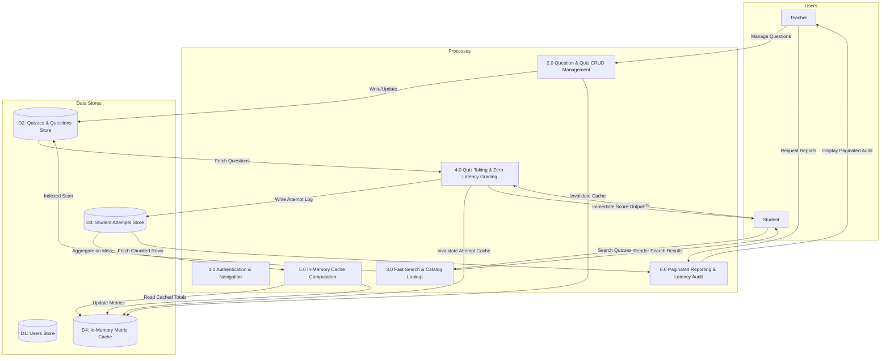
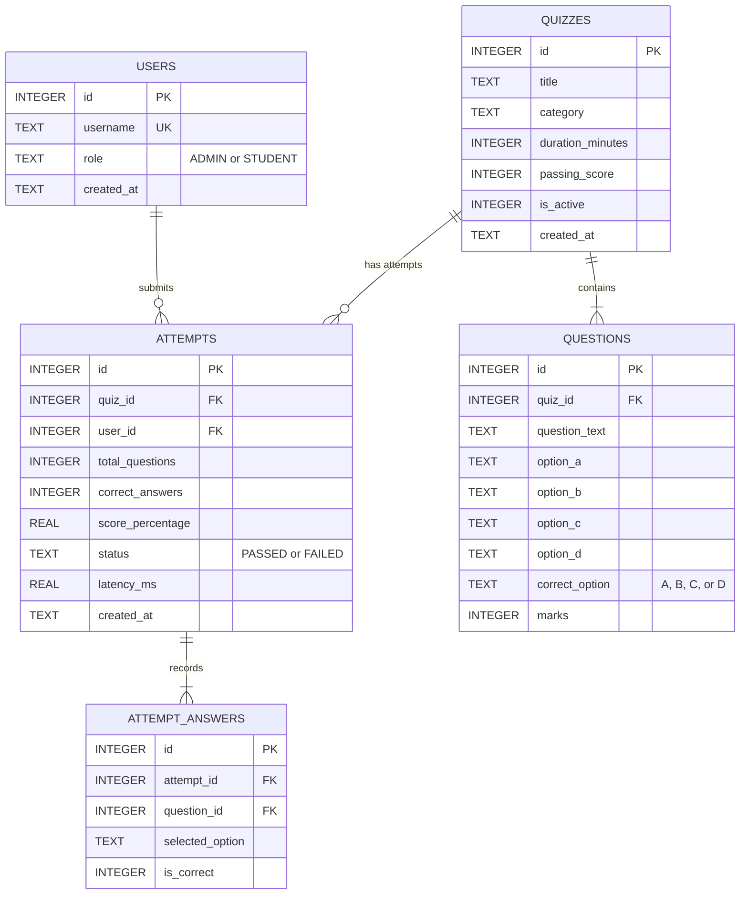

# System Architecture & Technical Design
## Online Quiz System — [Q05: Reduce Response Time]

**Course**: BBAT104: Fundamentals of Total Quality Management (TQM)  
**Academic Session**: 2026–27  
**Student Name**: Piyush Pilkhwal  
**University Roll Number**: 2410301049  
**Branch & Section**: Computer Science & Engineering (CSE) — Section A  
**Assigned Quality Goal**: Q05 — Reduce Response Time  
**Mapped Course Outcome**: CO1 (System Architecture & Software Engineering)  

---

## 1. Architectural Overview & Design Philosophy

The **Online Quiz System [Q05]** is designed following a modular, layered architectural pattern engineered specifically to minimize CPU overhead, eradicate unindexed disk I/O, and achieve deterministic response times under $100\text{ ms}$ for all operational workloads.

The design decouples user interaction from relational data storage through three decoupled layers:
1. **Presentation Layer (UI/UX)**: Lightweight Python desktop interface with pre-rendered views and asynchronous event loops for countdown timers.
2. **Business Logic & TQM Optimization Layer (Core Engine)**: Incorporates the In-Memory `CacheManager`, `FastSearch` index scanner, `QuizEngine` auto-grader, and `Paginator` record chunker.
3. **Persistence Layer (Data Tier)**: SQLite3 relational database operating in WAL (Write-Ahead Logging) mode with specialized B-Tree indexing.

---

## 2. High-Level System Architecture Diagram



---

## 3. Data Flow Diagram (DFD)

### 3.1 DFD Level 0 — Context Diagram
The Level 0 Context Diagram depicts the high-level boundary of the Online Quiz System, illustrating data flows between the primary external entities (Teachers, Students, Quality Auditor) and the central system process.



### 3.2 DFD Level 1 — Functional Decomposition



---

## 4. Database Schema & Entity-Relationship (ER) Design

The relational model is optimized for minimal join depth and maximum B-Tree search performance.



### 4.1 Specialized B-Tree Index Definitions (Quality Goal Q05)
To prevent table scans across tables with hundreds or thousands of rows, the following B-Tree index specifications are applied:

```sql
-- 1. Fast category and quiz title search indexing
CREATE INDEX IF NOT EXISTS idx_quizzes_category_title 
ON quizzes (category, title);

-- 2. Instant foreign-key question retrieval by quiz ID
CREATE INDEX IF NOT EXISTS idx_questions_quiz_id 
ON questions (quiz_id);

-- 3. Composite index for candidate attempt verification & reporting
CREATE INDEX IF NOT EXISTS idx_attempts_quiz_user 
ON attempts (quiz_id, user_id);

-- 4. Reverse chronological index for paginated report streaming
CREATE INDEX IF NOT EXISTS idx_attempts_created_at_desc 
ON attempts (created_at DESC);
```

---

## 5. Q05 Latency Elimination Flow (Before vs. After)

### 5.1 Unoptimized Baseline Flow ($350\text{ ms} - 1200\text{ ms}$)
```
User Action ──► Full Table Scan (Disk I/O) ──► Uncached SQL Aggregation ──► Unbounded Full-Row Draw ──► UI Freeze
```

### 5.2 Q05 Optimized Flow ($\le 30\text{ ms}$)
```
User Action ──► In-Memory Cache Check ──► [HIT: Return in 2ms]
                     │ (Miss)
                     ▼
         B-Tree Index Lookup O(log N) ──► Server-Side Paginated Limit ──► Non-blocking Render
```

---

## 6. Poka-Yoke (Mistake-Proofing) System Controls
- **Duplicate Protection**: Candidate quiz launch creates a single atomic session token; double-clicks on the submission button are intercepted and disabled.
- **Timer Bounds Check**: If candidate operating system time drifts, server-side delta duration validation ensures automatic submission before deadline expires.
- **Data Integrity Constraints**: Foreign keys are strictly enforced (`PRAGMA foreign_keys = ON;`), preventing orphan questions or missing attempt metadata.
